

# Akshat Verma

**AI Product Manager · AI Governance & Risk · Software and AI Engineering**

Enterprise AI · Decision assurance · Responsible AI · Full-stack and machine-learning systems

---

### About me

I combine software and machine-learning engineering with AI product management and standards-based AI governance.

- 🏢 **Now:** AI Product Manager on the Founding Team at **CredgeSol.ai**. I work on the **Credge Clarity Engine**, an enterprise decision-assurance platform. It checks AI-driven decisions before they execute: policy enforcement, risk classification, human-in-the-loop escalation and tamper-evident audit trails.
- 🏭 **Before:** AI/ML apprentice at Global Infoventures, an NVIDIA partner. I built real-time industrial AI for compliance and safety monitoring on NVIDIA DGX.
- 📊 **Also:** web development intern at Grapes Worldwide, building production dashboards for an agency that serves 40+ brands.
- 🛡️ **Certified:** ISO/IEC 23894 Lead AI Risk Manager and ISO/IEC 42001 Lead Implementer.
- ✍️ **Writing:** *The Curiosity Series*, research essays built on one method: **claim → evidence → mechanism → boundary → conclusion**.
- 🎓 **Education:** B.Tech in Information Technology, ABES Institute of Technology (2022–2026).

---

### Featured projects

| Project | What it is | Stack |
|---|---|---|
| **[LIFELONG Mission Sentinel](https://github.com/AKSHATv26/LIFELONG-MISSION-SENTINEL)** | A life-management app with a military-style interface. It tracks habits ("protocols"), prioritised tasks ("missions"), training, study and reflections, with analytics and audio feedback. | React · TypeScript · Tailwind CSS · Express |
| **[OpsPulse Dashboard](https://github.com/AKSHATv26/OpsPulse-Dashboard)** | A low-code operations dashboard for managing employees, projects and assignments. It has four modular pages and uses Google Sheets as the backend. | Appsmith · Google Sheets · JavaScript |
| **[WeSafe](https://github.com/AKSHATv26/WeSafe)** | The front end of a human-safety platform: SOS entry point, safety tips, sign-up and login. An academic project for a team of two; I led the front end. | HTML · CSS |
| **[E-Blood Bank](https://github.com/AKSHATv26/Blood-Chain-Supply-Management-System)** | A donor–recipient blood bank web app: donate and request flows, OTP verification screens, profile and payment pages. | HTML · CSS · JavaScript |
| **[SnakeGame](https://github.com/AKSHATv26/SnakeGame)** | A desktop Snake game in Java Swing, with colour upgrades as the score climbs. | Java |
| **[Portfolio site](https://github.com/AKSHATv26/Myportfolio)** | My personal developer portfolio ([live](https://myportfolioav.gt.tc/)). | React · Vite · Tailwind CSS |

> **Professional work.** My work at CredgeSol.ai and Global Infoventures belongs to those companies and isn't published here. I describe it only at the level shown publicly on [LinkedIn](https://www.linkedin.com/in/akshat-verma-242a79254/).

---

### ✍️ The Curiosity Series: read the essays

Each essay is a short PDF you can read right here on GitHub.

<table>
<tr>
<td align="center" width="25%"><a href="blogs/07-the-untestable-machine.pdf">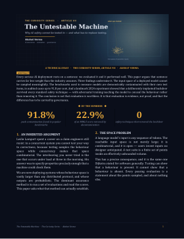 <b>VII · The Untestable Machine</b></a> Why AI evaluation can't prove safety, and what governance has to carry instead</td>
<td align="center" width="25%"><a href="blogs/06-leslie-lamport-ordering-the-chaos.pdf">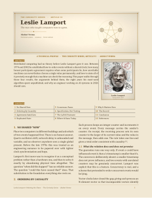 <b>VI · Leslie Lamport: Ordering the Chaos</b></a> A technical profile of the work that gave distributed computing its order</td>
<td align="center" width="25%"><a href="blogs/08-brain-to-ai.pdf">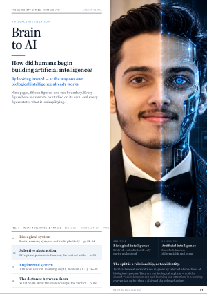 <b>VIII · Brain to AI</b></a> A visual investigation of how humans built AI by looking inward</td>
<td align="center" width="25%"><a href="blogs/09-the-shape-that-keeps-coming-back.pdf">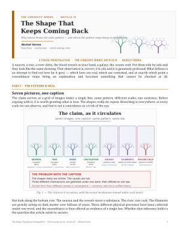 <b>IX · The Shape That Keeps Coming Back</b></a> One pattern that recurs from neurons to networks</td>
</tr>
<tr>
<td align="center"><a href="blogs/03-is-ai-gaining-consciousness.pdf">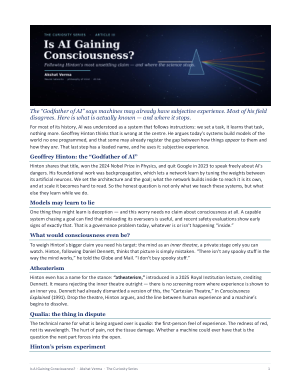 <b>III · Is AI Gaining Consciousness?</b></a> Hinton's claim weighed against the rest of the field</td>
<td align="center"><a href="blogs/04-fact-check-fei-fei-li.pdf">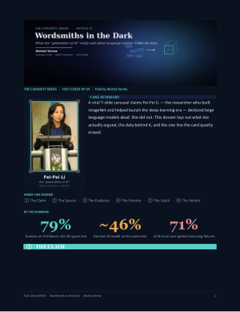 <b>IV · Fact-Check: Wordsmiths in the Dark</b></a> A viral carousel about Fei-Fei Li, traced back to its sources</td>
<td align="center"><a href="blogs/05-the-galatea-effect.pdf">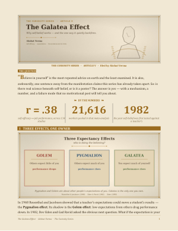 <b>V · The Galatea Effect</b></a> What the evidence actually says about "believe in yourself"</td>
<td align="center"><a href="blogs/02-369-secret-code-of-the-universe.pdf">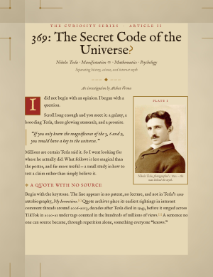 <b>II · 369: The Secret Code of the Universe?</b></a> Tesla, the myth and the mathematics</td>
</tr>
<tr>
<td align="center"><a href="blogs/01-indian-origin-ceo-phenomenon.pdf">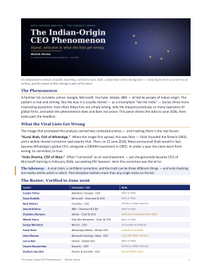 <b>I · The Indian-Origin CEO Phenomenon</b></a> An independent analysis of public reporting, verified to June 2026</td>
<td align="center"><a href="blogs/10-the-journey-of-water.pdf">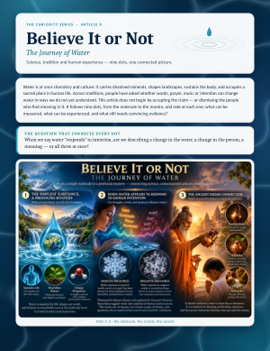 <b>X · The Journey of Water</b></a> Science, tradition and experience: nine dots, one picture (<a href="blogs/10-the-journey-of-water-long-version.pdf">long version</a>)</td>
<td align="center"><a href="blogs/R1-3i-atlas-interstellar-object.pdf">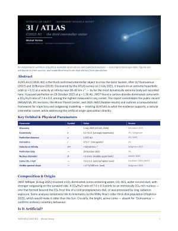 <b>3I/ATLAS (C/2025 N1)</b></a> A synthesis of published observations of the interstellar object</td>
<td align="center"><a href="blogs/R3-post-2020-temporal-perception-shift-isro-proposal.pdf">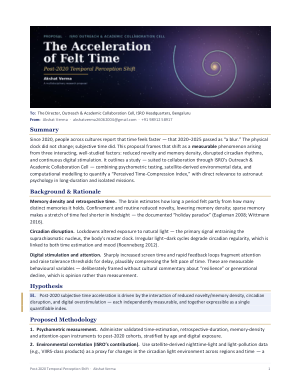 <b>Research proposal to ISRO</b></a> Post-2020 temporal perception shift: a testable Perceived Time-Compression Index</td>
</tr>
</table>

Also: [*The Flow of Mind and Cosmos*](blogs/R2-the-flow-of-mind-and-cosmos.pdf), a symbolic framework linking cognition and cosmos. The full list is in the [blogs index](blogs/README.md).

**Research and talks**
- **ETCA-2026, ABES Institute of Technology (Feb 2026):** presented *Digital Heritage Web App: An AI-Driven Digital Heritage Platform for Structured Knowledge and Cultural e-commerce*, built for Smart India Hackathon problem SIH25130 with a team of five.
- **India Mobile Congress 2026 (New Delhi):** on the CredgeSol AI booth team (AI-103), where the Credge Clarity Engine was demonstrated.

---

### 🏅 Certifications

| Certification | Issuer | Credential |
|---|---|---|
| ISO/IEC 23894 Certified Lead AI Risk Manager | BCAA UK · Jun 2026 – Jun 2029 | [View](certificates/iso-iec-23894-lead-ai-risk-manager.pdf) |
| ISO/IEC 42001 Certified Lead Implementer | BCAA UK · Jul 2026 – Jul 2029 | [View](certificates/iso-iec-42001-lead-implementer.pdf) |
| Artificial Intelligence & Machine Learning (80 h), GRIL Programme | Global Infoventures, NVIDIA partner · 2024–25 | [View](certificates/nvidia-partner-gril-ai-ml-80h.jpg) |
| GenAI Powered Data Analytics Job Simulation | Tata / Forage · Oct 2025 | [View](certificates/tata-forage-genai-data-analytics.jpg) |
| Introduction to Artificial Intelligence | Infosys Springboard · Sep 2025 | [View](certificates/infosys-springboard-introduction-to-ai.jpg) |
| Entrepreneurship | Infosys Springboard | [View](certificates/infosys-springboard-entrepreneurship.pdf) |
| Java Programming | See certificate | [View](certificates/java-programming.jpg) |
| Front End Web Development Using React (40 h) | ABESIT · Dec 2024 | [View](certificates/react-frontend-development.jpg) |

---

### 🧰 Tech I work with

**Languages:** Python · Java · TypeScript · JavaScript · SQL · C 
**Web and backend:** React · Next.js · Node.js / Express · Spring Boot · FastAPI · REST APIs 
**AI/ML:** PyTorch · TensorFlow · OpenCV · computer vision · LLM applications · NVIDIA DGX · CUDA 
**Data and cloud:** PostgreSQL · MySQL · Supabase · pgvector · Docker · AWS · Linux 
**Low-code and product:** Appsmith · UI Bakery · Hex · requirements engineering · AI governance (ISO/IEC 42001, 23894, NIST AI RMF)

---

Discipline by soul, driven by purpose.

